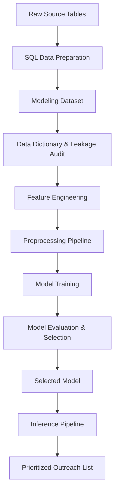

# Customer Retention Analytics Platform

A production-oriented machine learning platform that predicts voluntary customer churn for a telecom provider (ConnectTel Communications, a fictional client). It trains and evaluates candidate models, saves the selected model as a versioned bundle, and scores customers in batch into a ranked outreach list for the retention team. Risk tiers, per-customer drivers and a retention-economics simulation are in progress. The project is built to demonstrate production-oriented Applied Machine Learning engineering rather than focusing solely on maximizing model accuracy.

**Status:** model training and batch scoring are implemented, with evaluation results reported below; a dedicated evaluation command, business decision support and final documentation are in progress.

## Repository Guide

This repository is organized to support readers with different levels of interest, from a quick overview to a detailed engineering review.

| Reader | Time | Path |
|---|---|---|
| **Recruiter / skimmer** | 5 min | This README: problem → architecture diagram → results → limitations |
| **Hiring manager / engineer** | 30 min | README → `sql/` folder → `tests/` folder → one ADR of your choice in `docs/adr/` |
| **Deep reviewer / interviewer prep** | 2–3 hrs | README → all ADRs in `docs/adr/` → `docs/` folder → source code in `src/retention_platform/` |

**Note on planning documentation:** This project's planning documents (business, data, and system design) are kept in a separate private planning repository, not duplicated here — a decision recorded in [ADR-0002](docs/adr/0002-exclude-planning-docs-from-public-repo.md).

## Architecture

The diagram below shows the end-to-end data flow, from raw source tables to the ranked outreach list. Stages from raw data through model training and batch scoring are runnable pipeline stages in `src/retention_platform/`; the evaluation stage is a placeholder, and business decision support (risk tiers, per-customer drivers and a retention-economics simulation) is still in progress.



## Key Design Decisions

A few of the engineering decisions behind this repository, each recorded as an Architecture Decision Record (ADR) with full context and alternatives considered:

- **Python 3.12** was standardized on to ensure compatibility with XGBoost and the broader ML ecosystem — [ADR-0001](docs/adr/0001-python-version.md)
- **Planning documents are kept in a private planning repository**, separate from this public codebase, to keep this repository focused on the implemented system — [ADR-0002](docs/adr/0002-exclude-planning-docs-from-public-repo.md)
- **`uv` is used for environment and dependency management**, giving a single-command, reproducible setup — [ADR-0003](docs/adr/0003-use-uv.md)
- **DuckDB is used as the local analytical database engine** for all SQL-based data preparation, chosen over SQLite for its native CSV reading, warehouse-style SQL dialect, and clean pandas interop — [ADR-0004](docs/adr/0004-database-engine.md)
- **The raw dataset is committed to the repository** under `data/raw/` rather than downloaded at run time, so `make reproduce` works for a stranger with no dependency on an external mirror staying available — [ADR-0005](docs/adr/0005-raw-data-commit-policy.md)
- **The voluntary-churn target mapping is derived from `Churn Category`/`Churn Reason`**, excluding deceased customers entirely and documenting which classifications are dataset-backed versus explicit project assumptions — [ADR-0006](docs/adr/0006-voluntary-churn-mapping.md)
- **The business heuristic baseline flags customers on a month-to-month contract**, chosen over two alternative rules for the best balance of precision, recall, and whole-population coverage — [ADR-0007](docs/adr/0007-business-heuristic-baseline.md)
- **Final model selection is driven by the Primary Metrics as a set**, with the design's other named considerations (interpretability included, per its explicit textual support) used as tie-breakers when those metrics disagree, without inventing rankings the design doesn't specify — [ADR-0008](docs/adr/0008-model-selection-rule.md)

More Architecture Decision Records (ADRs) will be added as the project evolves, documenting significant engineering decisions throughout the implementation.

## How to Reproduce

**Prerequisites:** Python 3.12 and [`uv`](https://docs.astral.sh/uv/) installed.

Clone the repository and set up the environment:

```bash
git clone https://github.com/AmishaTiwari/customer-retention-analytics-platform.git
cd customer-retention-analytics-platform
uv sync --extra dev
```

`uv` automatically creates and manages the project's virtual environment — there is no separate manual environment setup step. This command creates the environment, installs the package in editable mode, and installs all development dependencies (see [ADR-0003](docs/adr/0003-use-uv.md)).

As additional pipeline stages are implemented, this section will expand to include a single end-to-end reproduction command (`make reproduce`) for the complete workflow.

## Results

Candidate comparison uses out-of-fold predictions from stratified 5-fold cross-validation on the 5,629 training rows, with each candidate calibrated (sigmoid, [ADR-0013](docs/adr/0013-calibration-method.md)). K is 10% of the scored customers ([ADR-0010](docs/adr/0010-precision-lift-k-value.md)).

| Candidate | Precision@10% | Lift@10% | PR-AUC | Brier |
|---|---:|---:|---:|---:|
| Business heuristic | 0.4583 | 1.7312 | 0.4360 | 0.3064 |
| Logistic regression | 0.8845 | 3.3417 | 0.7692 | 0.1102 |
| Random forest | 0.8828 | 3.3350 | 0.7768 | 0.1090 |
| XGBoost | 0.9059 | 3.4222 | 0.8004 | 0.1046 |

The selected model, calibrated XGBoost, was then fitted on the full training set and, after selection, evaluated on the held-out test set of 1,408 customers, together with the business heuristic. At K = 10%, 141 customers are flagged.

| Held-out test | XGBoost | Business heuristic |
|---|---:|---:|
| Precision@10% | 0.8936 (126 of 141) | 0.4043 (57 of 141) |
| Lift@10% | 3.3732 | 1.5260 |
| Recall at K | 0.3378 (126 of 373 churners) | 0.1528 (57 of 373 churners) |
| PR-AUC | 0.8032 | 0.4330 |
| Brier | 0.1017 | 0.3153 |

- Lift is Precision@K divided by the overall churn rate, so random selection scores 1.0.
- XGBoost is best on every Primary Metric in the cross-validated comparison, so step 1 of the selection rule applies ([ADR-0008](docs/adr/0008-model-selection-rule.md), [ADR-0014](docs/adr/0014-commit-9-model-selection-correction.md)).
- The held-out set was scored only for the selected model and the baseline, after selection, so there is no held-out comparison among candidates.
- Calibration was applied as the design requires; it did not improve the Brier score in training cross-validation (raw 0.1031, calibrated 0.1046).
- The gain chart and the reliability curve are not included yet. The held-out figures come from a one-time evaluation run after selection, not from a committed command.

## Limitations & Activated Fallbacks

The limitations below applied during implementation.

- The data represents a single snapshot rather than true longitudinal customer history, so temporal validation is out of scope.
- The churn label is an approximation of voluntary churn rather than a purpose-built distinction between voluntary and involuntary churn: the 6 deceased customers are excluded, and 176 of the 1,869 churned rows rest on two explicit assumptions ([ADR-0006](docs/adr/0006-voluntary-churn-mapping.md)).
- Cross-validation is not nested, and the preprocessing was fitted once on the training set before tuning and cross-validation, so the cross-validated estimates are mildly optimistic ([ADR-0014](docs/adr/0014-commit-9-model-selection-correction.md)).
- Calibration did not improve the Brier score for the selected model (raw 0.1031, calibrated 0.1046, training cross-validation); it was kept because the design requires it ([ADR-0014](docs/adr/0014-commit-9-model-selection-correction.md)).
- An early iteration compared candidates on the test split. This was corrected in [ADR-0014](docs/adr/0014-commit-9-model-selection-correction.md), so the held-out split was examined earlier in development. K = 10% ([ADR-0010](docs/adr/0010-precision-lift-k-value.md)) and the tuned-only candidate set ([ADR-0011](docs/adr/0011-commit-9-candidate-set.md)) were fixed before the correction, on analyses that used the test split, and were not re-derived.
- The data is a public IBM sample dataset with a fictional client.
- Evaluation rests on a single train/test split. At K = 10% the test set flags 141 customers, so one customer moves Precision@10% by about 0.007.

## Production Gaps

This project deliberately excludes several capabilities a production-grade deployment would require, in order to stay focused on core Applied Machine Learning engineering practices. Their absence is a scope decision, not an oversight.

- **CI/CD** — Tests currently run locally via `make test`. A production version would run this suite automatically on every push, likely via GitHub Actions.
- **Containerization (Docker)** — The project runs in a local, `uv`-managed environment. A production version would package the application in a container for consistent deployment across environments.
- **Cloud deployment** — The platform runs entirely locally. A production version would deploy the batch scoring job to a cloud environment (e.g., a scheduled cloud function or managed compute service).
- **Model monitoring & drift detection** — Model performance is evaluated offline, on a holdout test set. A production version would continuously monitor prediction quality and input data drift over time.
- **Feature store** — Features are computed directly within the pipeline. A production version serving multiple models or real-time use cases might centralize feature computation in a feature store.
- **Model registry / orchestration (e.g., MLflow Server, Airflow)** — Experiment tracking here is file-based, and pipeline stages run via the Makefile. A production version might adopt a managed registry and an orchestrator for scheduling and dependency management.

Each of these represents a natural next step if this platform were to move from a portfolio project toward an actual production system.

## Repository Map

```
customer-retention-analytics-platform/
│
├── README.md                # This file
├── pyproject.toml           # Package metadata and dependencies
├── Makefile                 # Project entry points and developer workflows
├── config/                  # Single configuration file (paths, seed, business parameters, tuning settings)
├── data/                    # Raw, interim, and processed data (git-ignored; rebuilt by pipeline)
├── sql/                     # Versioned SQL, numbered by execution order
├── src/retention_platform/  # Installable Python package (data, features, pipeline, models, evaluation, inference)
├── notebooks/               # Bounded exploratory work (dataset understanding, EDA only)
├── artifacts/               # Model bundles, evaluation metrics, and per-run experiment tracking
├── outputs/                 # Scoring output (prioritized outreach list and run summary); decision-support outputs are in progress
├── docs/                    # Architecture Decision Records (ADRs) and implementation documentation
└── tests/                   # pytest suite mirroring the package structure
```
